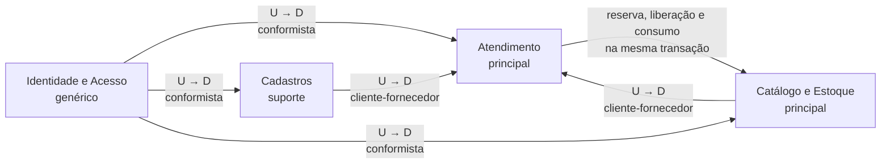

# Mapa de contexto

Os quatro contextos são módulos do mesmo monólito. A relação entre eles segue os padrões da DDD aula 4.

| Upstream | Downstream | Padrão | O que passa |
|---|---|---|---|
| Cadastros | Atendimento | cliente-fornecedor | `clienteId` e `veiculoId`, conferidos na abertura (cliente e veículo ativos, veículo do mesmo cliente). A OS guarda o cliente da época, então trocar o dono do veículo não muda OS antigas |
| Catálogo e Estoque | Atendimento | cliente-fornecedor | serviço e peça ativos com nome e preço atuais. Na publicação, descrição e preço são copiados para a versão do orçamento |
| Atendimento | Catálogo e Estoque | cliente-fornecedor, chamada síncrona | `reservarOrcamento()` na aprovação, `liberarReservas()` na reabertura e na finalização, `consumirPeca()` na execução. Tudo pela porta `EstoqueRepository`, dentro da transação do caso de uso |
| Identidade e Acesso | todos | conformista | `usuarioId`, perfil e `clienteId` vindos do token |

Código compartilhado: `domain/shared` tem só os erros de domínio (`ValidationError`, `ConflictError` e outros) e as funções de texto obrigatório e opcional. Nenhuma regra de negócio fica ali.

Não há eventos nem fila. A reserva precisa ser atômica com a decisão do cliente: se faltar uma peça, a aprovação inteira volta atrás. Por isso o caso de uso `DecidirOrcamento` chama a reserva de forma síncrona, na mesma transação, através da unidade de trabalho (`UnidadeTrabalho`), que entrega os repositórios dos dois contextos ligados à mesma conexão. Os eventos do Event Storming (`OrcamentoAprovado`, `PecaReservada` e outros) aparecem como registros no histórico de status e nos movimentos de estoque.
